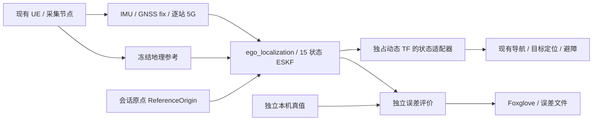

# GNSS + IMU + 逐站 5G-A 自机定位第一版

本版按交接包《自机定位_ROS2移植任务书.md》第 1–5 节实现，VIO 按本次确认留待下一阶段。默认保留真值控制，同时旁路发布融合估计和独立误差；可在控制台切换到融合控制。当前本机已编译并完成实际 UE 飞行和 rosbag2 回放。实测数字及限制见 [验收记录](ego_localization_acceptance.md)。

## 1. 启动与 Foxglove 操作

在项目根目录 PowerShell 中执行：

```powershell
.\scripts\start_console.ps1 -NoBrowser
```

使用终端输出的 `ws://127.0.0.1:<BridgePort>` 连接 Foxglove 桌面软件，添加 **EVTOL Simulation Console** 面板。如果 Foxglove 原来已经打开，请重新加载窗口，必要时删除旧面板后重新添加。新版本有 **自机定位** 页，位于“避障实验”和“数据采集”之间。`-NoBrowser` 只是不打开网页；不影响 Foxglove 桌面连接。若控制台已在运行，直接连接现有服务，不再重复执行启动命令。

建议操作顺序：

1. 暂停 ROS 实验，在“自机定位”选择 **GNSS + IMU**、**真值控制，融合旁路评价**，勾选“启用自机定位”和“独立真值误差评价”。先完成旁路验证。
2. 要接入逐基站测距，选择 **GNSS + IMU + 逐站 5G-A**。默认 RSRP 接受下限为 −100 dBm；每条链路分别门控并统计。
3. 要做中断恢复实验，勾选“启用 GNSS 异常测试”，填写时段，点击页面中的 **保存全部参数**。参数保存后需要停止并重新启动 ROS 实验才会生效，飞行中不会热切换滤波参数。
4. 按原有顺序启动 UE，等待 AirSim 就绪，再启动 ROS。总览的“执行飞行控制”决定本机是否飞行，与“启用定位”是独立开关。
5. 定位页显示当前三维误差、RMSE、P95、对齐覆盖率、状态更新频率、状态年龄、GNSS 测试阶段及误差曲线。详情包含逐基站接受/拒绝数、最近采用的观测时间、恢复创新及校正跳变。过期误差显示“过期 / 等待”，历史 RMSE 仍保留供查看。
6. 旁路稳定后，可停止 ROS，将“下游状态来源”改为 **融合定位控制**，保存并重新启动。首次建议低速、无障碍机验证，再增加复杂度。

数量、航线和 UE 设置仍在原页面维护，所有定位选项随控制台 JSON 的导入/导出一起保存。旧版控制台配置自动迁移至 v7；不会为了测试覆盖用户的 `console.local.json` 或机器路径。

融合模式的历史位姿需要等待同一时刻的点云。控制台自动把点云和检测等待预算至少设为 `reorder_s + 0.11 s`，并在制动速度上限中计入这一延迟；默认真值模式不变。若手写融合配置，请采用下方给出的完整示例，不要只改一个 `state.source` 字段。

### 轨迹与曲线

Foxglove 的 3D 面板选择固定坐标系 `map_enu`，添加：

- `/drone1/localization/path`：融合轨迹。
- `/drone1/localization/truth_path`：独立对照真值轨迹。
- `/drone1/navigation/waypoint_path`：任务航点轨迹。

旁路时 `/drone1/navigation/traveled_path` 表示真值控制的轨迹；切换融合控制后表示下游融合状态。它不能在旁路时充当融合轨迹。

Plot 面板可添加 `/drone1/localization/error_3d.data` 和 `/drone1/localization/error_enu.vector.x`、`.y`、`.z`，分别为三维范数及东、北、上误差，单位 m。原始里程计 `/drone1/localization/odometry` 可用于查看姿态和协方差。实时误差依赖独立评价节点；关闭评价后估计器仍正常工作。

## 2. Windows 环境与编译

沿用项目现有 Windows 11 / ROS 2 Jazzy / Pixi 环境，新增在线算法只需 ROS 消息、NumPy 和 PyYAML，无需为本版安装 Ceres、CUDA 或旧离线工程。实际路径由 `config/machine.local.json` 或现有环境变量配置；新增估计器不含本机磁盘绝对路径，不直接连接 UE。

换机先按项目原有环境文档安装 ROS、UE 和共享内存插件并配置机器路径；本功能不修改 UE 工程。首次构建整个工程：

```powershell
.\scripts\build.ps1
.\scripts\build_console_panel.ps1
```

已具备项目接口包的机器可仅增量构建本次相关 Python 包。编译前停止 ROS 和控制台，避免 Windows 正在占用可执行文件：

```powershell
. .\scripts\activate.ps1
colcon build --merge-install --executor sequential --packages-select evtol_localization evtol_simulation evtol_targeting evtol_console evtol_visualization evtol_collection evtol_bringup evtol_safety
```

编译后使用新终端重新激活环境。若修改面板源文件，应重新执行 `scripts/build_console_panel.ps1` 并重启控制台以安装新扩展。

## 3. 不使用面板时的完整启动配置

已提供四份独立、可编辑的完整 YAML。它们位于 `config/` 下，换机仍使用项目相对路径：

| 文件 | 模式 | 下游状态 | 异常测试 |
|---|---|---|---|
| `targeting.gnss_imu.yaml` | GNSS + IMU | truth | 关闭 |
| `targeting.gnss_imu_5g.yaml` | GNSS + IMU + 5G-A | truth | 关闭 |
| `targeting.fused_5g.yaml` | GNSS + IMU + 5G-A | fused | 关闭，点云预算已配套 |
| `targeting.gnss_outage.yaml` | GNSS + IMU + 5G-A | truth | 起飞后 40–60 s 中断 |

手动启动 UE 并确认使用当前 AirSim 配置后，例如：

```powershell
.\scripts\start_experiment.ps1 -Config .\config\targeting.gnss_outage.yaml -NewSession -Execute
```

`-NewSession` 需要之前的状态适配器已停止；不要在正在飞行的会话中重置原点。`-Execute` 才执行飞行控制，按需增加 `-Actors`。不要同时从控制台和终端启动两份实验栈。控制台主要使用自己的 JSON 配置，以上 YAML 不会自动替换控制台已保存的参数。

## 4. 异常与恢复的定义

```yaml
localization:
  enabled: true
  mode: gnss_imu_5g
  state_source: truth
  evaluate: true
  gnss_fault:
    enabled: true
    time_base: flight
    default_mode: normal
    segments:
      - {start_s: 0.0, end_s: 40.0, mode: normal, bias_enu_m: [0.0, 0.0, 0.0]}
      - {start_s: 40.0, end_s: 60.0, mode: dropout, bias_enu_m: [0.0, 0.0, 0.0]}
      - {start_s: 60.0, end_s: 90.0, mode: normal, bias_enu_m: [0.0, 0.0, 0.0]}
      - {start_s: 90.0, end_s: 95.0, mode: bias, bias_enu_m: [5.0, 0.0, 0.0]}
      - {start_s: 110.0, end_s: 120.0, mode: no_fix, bias_enu_m: [0.0, 0.0, 0.0]}
```

界面时段框只填写 `segments` 对应的 JSON 数组。区间左闭右开，必须按开始时刻排序、互不重叠，可设置多次中断；未列出的区间使用 `default_mode`，默认正常。

- `flight`：从本次控制器首次进入 `takeoff` 阶段起计时，原始仿真时间写入飞行状态的 `takeoff_stamp_ns`，回放时使用同一基准。没有执行飞行就不会开始这个计时。
- `session`：从 `/simulation/reference_origin.header.stamp` 起计时，适合无飞行控制器的数据包。不能将它和起飞计时混用。
- `dropout`：估计器丢弃该时段 GNSS 观测。
- `no_fix`：估计器按失锁拒绝该时段 GNSS 观测。
- `bias`：先在 fix 转换出的 ENU 位置加入指定偏置，再进行正常创新门控；大偏置可被拒绝，并非强行采用。
- `normal`：按有效状态、协方差与创新恢复更新，报告第一条恢复观测是否接受及校正跳变。

异常注入只作用于估计器的 GNSS 输入处理，不修改原始 `/gnss/fix`、星座或 UE，不屏蔽真值与 5G。这是可重复的失去 GNSS 位置更新实验；不是物理层卫星遮挡模型，也不是 RTK/伪距解算。原始消息保留在 bag 中，便于同包消融。

## 5. 架构、坐标与消息



| 方向 | 话题 | 说明 |
|---|---|---|
| 输入 | `/drone1/imu/data` | FLU 比力和角速度，100 Hz 目标；初始化允许使用其有效 ENU 姿态 |
| 输入 | `/drone1/gnss/fix` | WGS-84 经纬高，10 Hz 目标，位置更新只计一次 |
| 输入 | `/drone1/five_ga/observations` | 逐条 `measured_range_m`，10 Hz 目标，不再次融合 RTT |
| 输入 | `/simulation/geodetic_reference` | transient-local NavSatFix；采集端从实际 `getHomeGeoPoint` 获取一次，frame 为原始地图 `map` |
| 输入 | `/simulation/reference_origin` | transient-local；冻结会话 ID 与原始地图中的起点 |
| 输入 | `/drone1/control/flight_status` | 只读取异常测试计时，不作为位置观测 |
| 输出 | `/drone1/localization/odometry` | `map_enu → drone1/base_link`，实际处理历元，不改写旧样本时间 |
| 输出 | `/drone1/localization/status` | JSON String：新鲜度、阶段、采用数、拒绝原因、基站、恢复事件 |
| 输出 | `/drone1/localization/path` | 融合轨迹，Path，transient-local |
| 评价 | `/drone1/localization/metrics` | JSON String：独立真值误差及统计 |
| 评价 | `/drone1/localization/error_enu` | Vector3Stamped：估计减真值，东/北/上 |
| 评价 | `/drone1/localization/error_3d` | Float64：同一真值历元的三维误差范数 |
| 评价 | `/drone1/localization/truth_path` | 评价节点生成的真值 Path，transient-local |

`drone1` 随项目 namespace 配置变化。地理参考只定义地图的地理基准，不是实时位置。fix 经 WGS-84/ECEF 转原始地图 ENU 后减一次会话起点；基站已在原始地图 ENU，只减一次相同起点。ENU 不按起飞机头旋转。高度使用 AirSim 地理基准对应的椭球高度，不引入未标注的海拔/大地水准面修正。

输出 pose 为机体原点，姿态为 FLU 到 ENU；线速度发布为 `R.T @ v_enu`，角速度为去偏机体角速度，协方差包含坐标和相关项的变换。当前工程 GNSS/5G 安装在机体原点，杆臂默认 `[0,0,0]`；若修改安装位置，必须同步修改 `gnss_lever_flu_m`、`fiveg_lever_flu_m`，单位 m。

定位节点不订阅真值、下游 `/state/odometry`、动态 TF，也不执行 AirSim RPC。会话原点仍按原框架由真值冻结，只作为共享坐标约定；不用其初始真值姿态初始化滤波。滤波器只在初始化时允许使用已发布的有效 IMU 姿态，以后由去偏角速度传播。无有效航向时明确等待，不假造姿态。

状态适配器是唯一 `map_enu → base_link` 动态 TF 发布者；采集配置维持 `publish_truth_tf: false`。融合节点停止或状态时间戳过期后，适配器不重发旧位姿维持有效性。`state/status.age_s` 同时考虑接收年龄和消息时间戳年龄。

## 6. 估计器与参数

`src/evtol_localization/evtol_localization/` 的 `eskf.py`、`stream.py`、`geodesy.py` 和 `options.py` 与 ROS 接线分开。名义状态为 p/v/q/加速度零偏/陀螺零偏，误差状态 15 维。静止窗口可估计可辨识零偏；移动启动使用连续 fix 估计初始速度。IMU 去偏后旋转到 ENU 并加入重力。四阶状态转移、正权积分过程噪声、Joseph 协方差更新及姿态误差重置用于保持有效协方差。

关键配置均在 `config/targeting.yaml` 的 `localization` 中：

| 类别 | 参数与默认值 |
|---|---|
| 模式 | `enabled: true`，`mode: gnss_imu`，`state_source: truth`，`evaluate: true` |
| 时序 | `reorder_s: 0.24`，`stale_s: 0.30`，`max_imu_gap_s: 0.12`，`max_queue: 3000` |
| IMU | `gravity_mps2: 9.80665`，`accel_noise: 0.08`，`gyro_noise: 0.004`，零偏随机游走 `accel_bias_noise: 0.005`、`gyro_bias_noise: 0.0005` |
| 初始不确定度 | `initial_velocity_std_mps: 2`，`initial_attitude_std_deg: 2`，`initial_accel_bias_std: 0.1`，`initial_gyro_bias_std: 0.01` |
| 静止初始化 | `stationary_window_s: 0.5`，`stationary_accel_std: 0.08`，`stationary_gyro_max: 0.03` |
| GNSS | `gnss_sigma_floor_m: 0.3`，三维 NIS 门限 `gnss_nis_gate: 16.27` |
| 5G-A | `fiveg_sigma_floor_m: 0.15`，`fiveg_min_rsrp_dbm: -100`，单距离 NIS `fiveg_nis_gate: 16`，`fiveg_cauchy_scale: 3` |

这些是估计器噪声/门控参数，不是直接修改仿真传感器误差的参数。IMU 过程噪声按采样间隔离散化，单位采用 SI 连续噪声密度及对应零偏随机游走；发布 IMU 的零协方差表示未知。仿真误差源仍在现有 AirSim 与 `source_parameters.yaml` 中配置。

5G 使用 `max(range_sigma_m, fiveg_sigma_floor_m)^2`，检查有限性、正测距、有效标志、RSRP 和创新。按站使用 Cauchy 降权，不读取仿真 LoS/NLoS 标签、真距离或注入偏差。该版未把 GNSS raw 和 fix 作为两份独立观测；伪距观测缺少卫星 ECEF，后续应独立补齐后再实现观测级解算。

异步输入使用传感器头时间和有界排序，重复样本、超窗迟到、超队列明确计数；不通过修改时间戳掩盖延迟。IMU 大间断使滤波状态失效并重新等待初始化。诊断区别初始化、正常、仅惯性传播和过期。**排序等待导致约 246 ms 状态年龄，本版未达到协议 30 ms 指标**，后续需要历史校正并重传播到最新 IMU；单纯调小排序窗口会丢弃当前有延迟的 GPS，不应当作达标办法。

## 7. 录包、回放与同包对比

在面板“数据采集”导入 `config/collection.localization.json`，即可录制定位所需输入、两种参考、飞行计时、状态、融合结果及独立真值；不包含高带宽相机，适合定位验证。结束后必须等待录制状态变成 completed，检查两个参考话题都有消息。该版修复了 DDS 话题先出现、发布端 QoS 后出现时漏录静态参考的问题，等待端点发现后才建立 transient-local 订阅。

也可以使用原有全量录制脚本，它已增加定位话题和参考的 QoS：

```powershell
.\scripts\record.ps1 -Output .\bags\localization_trial
```

仅回放估计器和评价节点时，停止实时实验。在两个已激活且 DDS 域相同的终端中执行：

```powershell
# 终端 A；不要同时启动实时采集或状态适配器
. .\scripts\activate.ps1
$env:ROS_DOMAIN_ID='224'
ros2 launch evtol_bringup ego_localization_replay.launch.py "config:=$((Resolve-Path .\config\targeting.gnss_outage.yaml).Path)"
```

```powershell
# 终端 B；路径指向有 metadata.yaml 的 rosbag2 目录
. .\scripts\activate.ps1
$env:ROS_DOMAIN_ID='224'
.\scripts\replay_localization.ps1 -Bag .\bags\localization_trial
```

回放脚本只播放传感器、参考、飞行计时和独立真值，由播放器生成唯一 `/clock`；排除录制的估计、状态和 TF。无动态 TF 的估计/评价回放不需要启动状态适配器；3D 查看两条 `map_enu` Path 即可。如需连接 Foxglove 桥接，请在相同 DDS 域启动只读桥接，勿再次启动实验节点。评价结果写入配置中的 `evaluation.output_dir/ego_<session>/<mode>/`，重复同模式回放会覆盖该目录，保存实验时请改输出目录。

四组同包因果对比可使用：

```powershell
. .\scripts\activate.ps1
python .\scripts\compare_localization_bag.py .\bags\localization_trial --config .\config\targeting.gnss_outage.yaml --output .\reports\localization_comparison
```

输出目录必须尚不存在。脚本在同一份包上比较 GNSS+IMU 与增加 5G 的正常/40–60 s 中断四组，输出 `comparison.json` 和四份逐历元误差 JSONL。它使用与在线节点相同的估计核心，按录制时刻控制样本可用性、头时间控制融合，不做全段平滑；不是端到端 ROS 发布延迟测试。若包缺少匹配参考或起飞计时会明确失败，不从真值倒推地理基准。

## 8. 验证与交付文件

```powershell
. .\scripts\activate.ps1
python -m unittest discover -s tests -p "test_ego_localization*.py" -v
```

该测试包括真实 ROS private DDS 接线验证：非零会话起点、融合输出逐消息转发、断星恢复、有效 5G、独立误差及停止输入后状态失效。`tests/probe_ego_localization.py --root <项目目录> --seconds 90 --fused` 是可复现的实际 UE 测试，会暂时启动自有仿真进程并在结束后恢复用户配置与会话文件；运行前应停止其他 UE/实验。`tests/probe_localization_replay.py` 验证实际 ROS 回放。

主要交付位置：

- `src/evtol_localization/`：新增在线滤波器、ROS 估计节点与独立评价节点。
- `config/targeting*.yaml`、`config/collection.localization.json`：模式、异常、回放与采集示例。
- `src/evtol_simulation/evtol_simulation/sensor_node.py`：发布采集端同源地理参考。
- `src/evtol_targeting/evtol_targeting/state_node.py`：融合转发、坐标和时间戳新鲜度检查。
- `src/evtol_bringup/launch/`：在线启动接入和仅定位回放。
- `src/evtol_console/`、`foxglove/evtol-console/`：定位配置、状态、误差展示与新扩展。
- `src/evtol_collection/`、`scripts/record.ps1`、`bag_qos.yaml`：定位白名单、参考 QoS 与录包发现修复。
- `src/evtol_safety/evtol_safety/gateway.py`：仅增加飞行时刻元数据；未改飞行控制算法。
- `scripts/compare_localization_bag.py`、`scripts/replay_localization.ps1`、`tests/test_ego_localization*.py`：同包分析、回放及回归。
- `references/ego_localization/`：交接任务书、原 C++/Ceres 算法与历史证据，附来源 ZIP SHA-256。历史证据不作为在线验收数字。

旧工程复用了 IMU 状态顺序、噪声与协方差传播约定，以及逐站测距残差、标准差下限、RSRP 过滤和 Cauchy 鲁棒思想。15 状态在线 ESKF、fix 更新、ROS 时序缓存、地理参考接线、独立评价及界面属于本次新增实现。没有将离线 Ceres 循环调用成“在线定位”。
