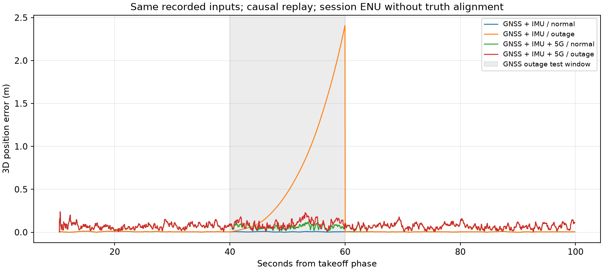

# 自机定位第一版：实测验收记录

本记录来自本机 Windows 11、ROS 2 Jazzy、UE 4.27 / 当前 Cosys-AirSim 工程。不是旧 Ceres 离线精度的复用，也不是理想 mock 精度。

## 同一实际飞行包的四组对比

实际飞行为 GNSS+IMU+5G-A 融合控制，0.7 m/s，航线 `[0,0,8] → [0,60,8]`，无障碍机；观察约 90 s，期间持续正常飞行。GPS 原始消息完整保留，断星只屏蔽估计器的 GNSS 更新。对同一包按录制接收顺序运行相同 FusionStream，使用消息头时间和有界排序，不进行整段平滑、不把真值用于估计或拟合坐标。四组从包内相同初始观测重新初始化，因此与飞行前已初始化的在线结果略有差别。

表内“窗口”为起飞阶段开始后 40–60 s；正常组也在相同窗口计算。恢复跳变为恢复后第一条 GNSS 更新造成的位置校正量。覆盖率包含包起始时的未初始化历元，计分末端统一等待 0.55 s，尾部未完成历元不计入四组分母。

| 模式 | 全程 RMSE m | P95 m | 窗口 RMSE m | 窗口末端误差 m | 恢复跳变 m | 对齐覆盖率 |
|---|---:|---:|---:|---:|---:|---:|
| GNSS + IMU / normal | 0.0054 | 0.0091 | 0.0054 | 0.0064 | — | 99.67% |
| GNSS + IMU / outage | 0.4566 | 1.2367 | 0.9547 | 2.4083 | 2.4190 | 99.67% |
| GNSS + IMU + 5G / normal | 0.0724 | 0.1160 | 0.0648 | 0.0973 | — | 99.67% |
| GNSS + IMU + 5G / outage | 0.0829 | 0.1437 | 0.1063 | 0.1033 | 0.0044 | 99.67% |

当前仿真原生 GPS 很理想，正常时 GNSS 基线优于增加带噪声和 NLOS 偏差的 5G。5G 在断星时显著约束漂移，但不能据此宣称对任何场景、遮挡和基站几何都提升精度。未根据真值选择链路，未读取 `is_los`、`true_range_m` 或 `nlos_bias_m`。单站与差几何仍保留相应不可观方向的不确定度。

## 在线 UE 融合控制

- 三维 RMSE **0.0800 m**，P95 **0.1417 m**；断星阶段 RMSE **0.1061 m**。
- 断星末端 **0.1033 m**；恢复校正 **0.0044 m**，创新门控接受。
- 最终状态窗口发布频率 **43.78 Hz**；状态年龄 P95 **246.0 ms**、最大 **249.0 ms**。
- 采用 IMU 10349 条、GNSS 831 条、逐站 5G 6196 条；GNSS 人为屏蔽 200 条。6 个基站分别统计接受和拒绝。
- 录包已正常结束，队列丢弃 0；地理参考、会话原点各录到 1 条，已验证 transient-local 回放。
- 控制台用户配置 SHA-256 未变；测试后恢复原会话文件，测试所拥有的 UE、ROS 和录制进程均已退出。

融合模式曾因 240 ms 排序延迟超过原点云 200 ms 预算而拒绝起飞，已修复：控制台生成融合配置时将点云历史处理预算至少设为 `reorder_s + 0.11`，并将相同延迟纳入原有制动速度限制；没有改写定位或点云时间戳。真值模式不改变该预算。

## 软件与回放验证

- 定位解析、ESKF、坐标、单站可观性、杆臂、重复/乱序、GNSS 中断、偏置、无效 fix、恢复和真实 ROS 转发/超时测试通过。
- 既有控制台、三相机、采集 MCAP/SQLite 回读、目标定位与融合实验回归通过。
- Foxglove TypeScript 检查、面板交互测试和扩展打包通过；交互测试覆盖模式切换、时段保存、误差值、曲线及过期提示。
- 实际 rosbag2 → ROS 估计/评价节点回放在独立 DDS 域进行，没有启动 UE、采集节点、状态适配器或动态 TF，也没有回放录制的估计输出。
- 实际 ROS 回放接收 2801 条估计消息，RMSE 0.0835 m，覆盖率 99.51%；恢复事件已出现，输出时间严格递增。回放倍率 2，进程间调度会造成与纯算法回放不同的少量丢样。

## 验收边界与后续

本版采用任务书允许的有界延迟排序。状态更新频率达到本次测试约 40 Hz 的水平，但**约 246 ms 的状态年龄不满足技术协议 ≤30 ms 的目标**。小矩阵滤波计算耗时不能代替状态年龄。后续应实现迟到观测历史更新并重传播到最新 IMU 历元，再测量传感器延迟和端到端发布延迟。

本次没有做覆盖多场景/多速度/多随机种子的位置 2σ 统计验收，也未完成降落末段垂直 0.5 m (2σ)、完整姿态指标和 GNSS 长时间中断的协议验收；当前表格只是这一条慢速航线的独立误差。仿真 GNSS 与 IMU 初始姿态的理想程度也应纳入后续退化实验。VIO 与 GNSS 原始伪距模式未在本版接入。

## 原始证据

- `reports/ego_localization_20261120_143227/result.json`
- `reports/ego_localization_20261120_143227/comparison/comparison.json`
- `reports/ego_localization_20261120_143227/ros_replay/result.json`
- `reports/ego_localization_20261120_143227/sensor_bag/bag_20261120_143256_3a22eb4a/rosbag2`

`comparison/*_errors.jsonl` 保存逐真值历元误差，在线 `data/console_runs/ros_20261120_143236_df8e21/evaluation/ego_<session>/gnss_imu_5g/` 保存实时评价原始值。首次旁路 GNSS+IMU 断星实测另见 `reports/ego_localization_20261120_141034/result.json`。
