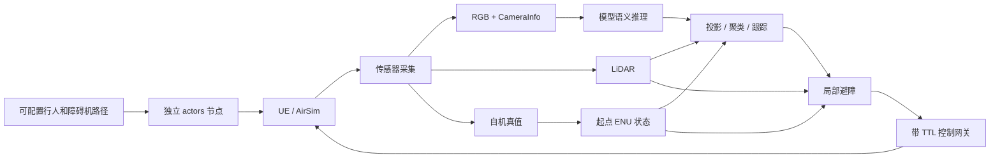

# 激光视觉目标定位与独立场景控制

2026-11-07 更新：三维航点和全向避障已加入，启动与参数见 [三维航点飞行与避障](三维航点飞行与避障.md)。原前向雷达继续负责目标定位，独立 NavigationLidar 负责导航。

实现日期：2026-11-06。运行工作区为 `evtol_project_ros2`；算法移植自相邻 `evtol_realtime_uav`，使用该工程的 `model/best.pt`。本说明中的命令以 ROS 工作区为当前目录。

## 1. 已实现的功能与分工

| 功能包 | 职责 |
| --- | --- |
| `evtol_simulation` | UE 传感器采集、标准话题、原始自机真值；相机和雷达保持 Windows 共享内存传输 |
| `evtol_perception_interfaces` | 原点、状态质量、语义帧、三维目标、风险和带有效期速度指令 |
| `evtol_targeting` | 起点 ENU 状态适配、真实语义模型推理、激光视觉定位、Kalman/Hungarian 跟踪、独立几何评估 |
| `evtol_safety` | 独立雷达保护、局部速度候选、动态 CPA 风险、唯一主机控制网关 |
| `evtol_scenario` | 新增 `actors_node`，独立控制行人和障碍机，路径由 YAML 配置；保留旧入口 |
| `evtol_visualization` | Foxglove 桥接与预览，包含算法输出 |
| `evtol_bringup` | 全链路、纯算法、纯场景控制三个 launch 入口 |



目标位置来自 RGB 模型预测与实际雷达回波。目标真值只进入评估节点，未作为检测和跟踪输入。输出参考点为 **可见表面中心**，不等同于目标几何中心；目标姿态未估计，消息 `orientation_valid=false`。自机真值 Odometry 包含完整位置、姿态和速度。

## 2. 模型与可迁移环境

ROS 环境与模型环境分开：ROS 使用现有 Jazzy/Pixi Python 3.12；模型使用独立 Python 3.11。节点之间走 ROS；视觉节点与其模型子进程之间使用共享内存传递图像和标签，控制消息走 stdin/stdout。ROS Python 不导入 torch。

- 权重：`models/best.pt`。
- SHA256：`8e15841986e6c4a16458aca83cad757a04f7eb76ed00e169c0c2e28340de3e98`。
- 模型实际任务：`semantic`。类别：0 背景、1 aircraft、2 high_rise、3 pedestrian、4 ground、5 runway、6 drone。
- 已随工程带入定制运行时 `models/semantic_runtime/ultralytics`，保留其 AGPL-3.0 LICENSE；官方 pip Ultralytics 不能替代此版本。
- 算法侧私有依赖：`.algorithm_deps/scipy==1.13.1`，通过激活脚本加入路径，不替换 ROS 的 NumPy。
- 模型侧依赖锁定于 `environment/requirements-model.txt`，已验证 torch 2.11.0+cu128、torchvision 0.26.0、Python 3.11.15。无 CUDA 时明确回退 CPU，需重新测量频率。

新 Win11 机器先按原工程环境文档安装 ROS2、VS C++ 工具链和匹配 UE 插件，再创建模型环境：

```powershell
conda create -n evtol-semantic python=3.11 -y
.\scripts\install_algorithm.ps1 -ModelPython D:\Miniconda\envs\evtol-semantic\python.exe -InstallModelDependencies
.\scripts\build.ps1
. .\scripts\activate.ps1
python scripts\check_model.py --config config\targeting.yaml
```

将示例中的 Python 路径替换为实际路径。安装脚本写入 `config/machine.local.json` 的 `ModelPython`，也可用环境变量 `EVTOL_MODEL_PYTHON` 覆盖。已存在旧模型环境时去掉 `-InstallModelDependencies` 即可复用。`check_model.py` 使用零图检查模型加载及共享内存协议，其结果不是目标识别准确率测试。

迁移时带上 `src/`、`config/`、`scripts/`、`environment/`、`models/` 和文档；重新编译生成本机 `build/`、`install/`。本机绝对路径集中在 `machine.local.json`，不要复制旧机器的运行数据和原点作为新实验初始点。

## 3. 启动顺序

先启动与原工程一致的 UE 场景，确认 RPC 41451、双路 2K 相机和雷达共享内存可用；`start_experiment.ps1` 不启动 UE。

首次实验应在主机起飞前运行：

```powershell
cd D:\ZAD_Files\evtol_files\evtol_project_ros2
.\scripts\start_experiment.ps1 -NewSession
```

该入口同时启动六组采集和算法，**默认 shadow，只发布安全速度，不控制 Drone1，也不移动场景目标**。`-NewSession` 归档已有原点；同一会话重启算法时不加该参数。已有原点适配器运行时禁止重置。

如果上次默认 shadow 实验仍在后台，先运行 `scripts/stop_experiment.ps1`，再运行 `scripts/start_experiment.ps1 -NewSession`。停止脚本仅处理本工作区的 `execute:=false actors:=false` 全链路实验及子进程，保留 UE、Foxglove 和原点文件；检测到飞行或场景控制模式会拒绝强制停止。不要只终止原点节点，否则会留下采集进程并占用传感器。

新终端可分别启动：

```powershell
# 独立移动行人和障碍机
.\scripts\start_actors.ps1
# 可视化
.\scripts\start_visualization.ps1 -Viewer foxglove
```

也可用 `start_experiment.ps1 -Actors` 同时启动场景目标。单独停止目标时先执行：

```powershell
.\scripts\stop_actors.ps1
```

等待服务返回 `success=True` 后再结束场景 launch。默认会取消任务、降落障碍机、解除解锁并释放 API 控制权。Windows 强制终止进程不能保证执行 Python 的 finally，因此不能将直接关闭窗口当作可靠的降落流程。

若已经有符合算法要求的采集节点，只启动算法：

```powershell
.\scripts\start_targeting.ps1
```

此时采集配置须用 `src/evtol_simulation/config/simulation.perception_2k.yaml`，其中 `publish_truth_tf=false`。不要同时启动第二套采集，或启动会控制 Drone1 的旧 `scenario_node`。进程互斥会拒绝同一传感器或同一车辆的重复所有者。

需要实际执行主机控制时，先用 `start_ue.ps1` 加载 `airsim.navigation_2k.json`，在起飞前设置 `control.takeoff_on_start: true`，用 `start_experiment.ps1 -NewSession -Execute` 启动。网关等到会话、状态和全向点云保护指令齐备后解锁，起飞和航点均使用受保护的速度闭环。已在空中的主机保持 `takeoff_on_start: false`。末点为空中高度时悬停；末点对应配置地面高度且 `mission.land_at_last: true` 时执行监视降落，确认实际触地后解除解锁。

## 4. ENU 原点、真值与融合定位接口

`map_enu` 为 X 东、Y 北、Z 上，原点冻结在主机起飞前初始点，轴向不会随初始机头转动。初始机头朝北时，向前为 +Y。

- 原始真值 `/drone1/ground_truth/odometry` 保留原始 `map` 数据。
- 起点真值 `/drone1/ground_truth/local_odometry`：位置减初始点，完整姿态保持 ENU。
- 算法唯一状态接口 `/drone1/state/odometry` 与 `/drone1/state/status`。
- 原点 `/simulation/reference_origin` 使用 transient-local，含会话 ID、原始 ENU 起点和初始姿态。
- `ego_state_adapter` 独占动态 TF `map_enu -> drone1/base_link`；传感器安装 TF 仍由仿真层提供。
- 原点保存在 `data/session_origin.json`。换出生点或重置 UE 后，在起飞前明确建立新会话，不能沿用过期文件。

未来将 `state.source` 改为 `fused`，融合节点发布 `state.fused_topic` 指定的 Odometry，默认为 `/drone1/localization/odometry`。输入必须处于同一会话 `map_enu`，姿态表示 body FLU 到 ENU，twist 遵循 Odometry 约定位于 `child_frame_id`；不得由融合节点重复发布相同动态 TF。状态适配器继续发布真值供对照。当前尚未实现融合算法。

## 5. 主机路径与定位参数

主配置：`config/targeting.yaml`。相对文件路径以该文件所在 `config` 的上级工作区解析，自定义配置请仍放在工作区 `config/`。

```yaml
mission:
  waypoints_enu_m: [[0.0, 30.0, 3.0], [0.0, 50.0, 3.0]]
  speed_mps: 2.0
  tolerance_m: 0.7
```

这是起点 ENU 位置，单位米，速度为 m/s。默认启用全向导航雷达和三维局部绕行规划，支持上升、下降、侧向、反向及斜向航点。默认 2 m/s 低速；任务、规划器和网关速度上限需一致配置。无可行局部路径时停车并报告原因。关闭 `navigation_lidar.enabled` 会回退到旧前向有限视场控制，此模式仍会停止未观测方向的指令。

`detection.target_class_ids: [3,6]` 控制定位类别；激光几何保护使用全部回波，不依赖语义类别。`extrinsics` 应与仿真采集安装参数一致。默认相机前移 0.3 m、俯仰 -10°；融合以采集时间查询历史位姿并补偿自机运动，最大图像/雷达时间差 50 ms。无雷达深度时输出 `NO_TARGET_DEPTH`，不构造三维目标。

## 6. 行人和障碍机路径配置

独立配置 `config/actors.yaml`。默认保留旧工程 Drone2–Drone5 与 `Pedestrian_2` 的路径、出生偏移及朝向逻辑；场景中必须存在这些车辆和 Actor。

障碍机示例：

```yaml
- vehicle_name: Drone2
  spawn_offset_ned_m: [30.0, 0.0, 0.0]
  coordinate_mode: initial_enu
  speed_mps: 2.0
  start_delay_s: 1.0
  repeat: 0
  hold_s: 0.5
  waypoints: [[0.0, 30.0, 8.0], [5.0, 30.0, 8.0]]
```

| 障碍机 coordinate_mode | 航点语义 |
| --- | --- |
| `relative_heading` | 旧工程 FRD：前、右、下，随主机初始姿态变换；兼容字段 `waypoints_frd_m` |
| `relative_start` | 主机起点相对位移，NED：北、东、下 |
| `initial_enu` | 主机起点 ENU：东、北、上，推荐用于新实验 |
| `relative_initial` | 相对该障碍机启动时的位置，NED 位移 |
| `absolute_ned` | AirSim 该车辆 API 的本地 NED 绝对位置 |

`spawn_offset_ned_m` 必须与 AirSim settings 中车辆相对主机出生位置一致。前三种主机相对坐标会减去车辆出生偏移一次，再提交给该车辆本地 API；后两种已经是车辆本地坐标，不能再次加减偏移。此逻辑有旧路径与 ENU 转换回归测试。

`repeat: 0` 为无限循环，正整数为循环次数；单航点到达后悬停。`hold_s` 为每点停留，`start_delay_s` 为启动延迟；未设置时障碍机按全局 `takeoff_stagger_s` 错峰。不要同时配置 `waypoints` 和 `waypoints_frd_m`，兼容字段优先。

到点按实际三维距离检查，`waypoint_tolerance_m` 默认 0.5 m，可在全局 `interference_drones` 或单机项覆盖。任务未到点会最多尝试三次，仍超限则报告错误；不会只依据 AirSim 的布尔返回值认定轨迹执行成功。

行人示例：

```yaml
- name: Pedestrian_2
  coordinate_mode: relative_initial
  speed_mps: 1.0
  loop: true
  hold_s: 0.0
  waypoints: [[8.0, 0.0, 0.0], [0.0, 0.0, 0.0]]
```

行人支持 `relative_initial`（相对 Actor 初始位置的 NED 位移）、`initial_enu`（主机起点 ENU 位置）、`absolute_ned`（场景对象 API 的 NED 位置）。方向和动画前向偏角由 `pedestrians.forward_yaw_offset_deg` 控制，默认沿用 -90°。位置按实际墙钟步长以默认 30 Hz 更新，不越过航点；UE 的 Actor 运动使用 `simSetObjectPose`，不等同于真实行人动力学。

默认障碍机在约 10 m 高处，而地面主机的相机下俯、垂直视场较窄；目标不在视野中时不会强行输出定位。实验要共同设计自机高度、目标路径、相机和雷达视场。

## 7. Foxglove / RViz2

Foxglove 连接 `ws://127.0.0.1:8765`，3D 面板固定坐标系设置 `map_enu`。

| 话题 | 显示用途 |
| --- | --- |
| `/drone1/preview/rgb/image/compressed` | RGB 预览 |
| `/drone1/perception/semantic_preview/compressed` | **实际模型预测**的语义标签图 |
| `/drone1/preview/semantic/image/compressed` | UE 语义真值预览，对照用 |
| `/drone1/preview/lidar/points` | 降采样点云 |
| `/drone1/perception/markers` | 三维轨迹球和 ID 文字，含预测 |
| `/drone1/perception/targets_measurements` | 本次实际三维测量 |
| `/drone1/perception/tracks` | 预测轨迹、速度、协方差、最后观测时刻 |
| `/drone1/ground_truth/local_odometry` | 起点 ENU 自机真值位置和姿态 |
| `/drone1/control/safe_velocity`、`/drone1/safety/risk` | 安全指令与风险，Raw Messages / Plot 面板 |

RViz2 同样将 Fixed Frame 设为 `map_enu`，添加 TF、PointCloud2、MarkerArray、Odometry，传感器话题 QoS 选择 Best Effort。旧预览配置的 `map` 固定坐标不适用于这套新动态 TF，应手动改为 `map_enu`。模型预测标签图为压缩图片；ROS 常规图像插件需支持 compressed transport，Foxglove 可直接显示。

## 8. 验证与实验步骤

```powershell
. .\scripts\activate.ps1
python -m unittest discover -s tests -v
python scripts\observe_targeting.py --seconds 60 --output reports\targeting_live.json
```

前者包含采集回归、几何/时间插值/遮挡/聚类/跟踪、路径坐标转换、ROS 节点测量、空雷达停车，以及仿真时钟暂停时避障仍运行的检查。后者只读实际话题，保存频率、间隔、目标数量、状态分布、推理耗时及采集年龄。采集年龄使用 20 Hz `/clock`，有约一个周期量化误差；几毫秒负值不代表跨机器时钟已同步。

推荐依次开展：静态单目标，单目标横穿，同类双目标交叉，行人移动，短时遮挡，雷达空帧/数据暂停，最后低速主机闭环。记录不同距离和光照下的有深度检出率、位置误差、轨迹中断、最小间距、停车触发原因、P50/P95/P99 延迟与收帧间隔。闭环实验还需记录实际碰撞和未观测方向停车次数。

独立评估输出在 `data/evaluation/<日期时间>/target_errors.jsonl`。目前对障碍机真值进行时间插值和几何匹配，同时保留未匹配/大误差候选；字段明确标记 `geometric_only_surface_to_vehicle_origin_not_identity_verified`。它比较可见表面中心与车辆原点，**不能视为具有独立身份的几何中心误差验收**。行人真值、Actor 命中身份审计以及协议级预警准确率/漏警率统计尚未实现。

录制整个实验可用：

```powershell
ros2 bag record -s mcap -o bags\targeting_run --all
```

包含双路 2K 原始图像，文件较大，需按磁盘吞吐调整录制范围。当前没有交付专用离线回放 launch；不得在实时 UE 算法栈仍运行时直接叠加回放同名话题。离线模式仍需增加禁用所有 RPC 的启动约束和独立原点会话处理后验证。

## 9. 实测记录与边界

实测数据与限制见同目录 `目标定位实现验证记录.md`。

本版实现全向雷达覆盖下的低速三维局部绕行与速度保护，不提供全局地图、SLAM、多源自机定位、目标姿态估计或任意环境下的安全与可达性保证。被占据的目标或超出局部规划能力的路线会停车。当前相机已有 200 ms 排序缓冲，完整视觉链路不能宣称 30 ms。雷达数据失效、无采集时刻位姿、点数超限及指令过期会降级为零速度；协议中预警准确率、漏警率、误警率等指标尚未验收。
